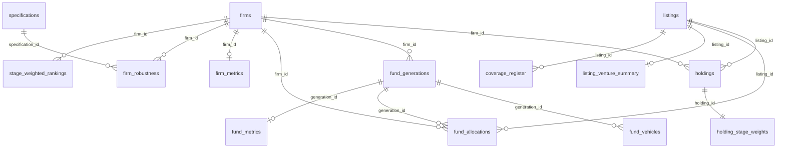

# Venture value created per dollar at risk

**US venture-backed listings, January 2014 – June 2026 (excluding life sciences): who owned them, which funds held the stakes, and how much value each venture firm and fund created per dollar of capital at risk.**

<!-- DOI-BADGE -->[](https://doi.org/10.5281/zenodo.23455286)<!-- /DOI-BADGE --> · Licence: [CC-BY-4.0](https://creativecommons.org/licenses/by/4.0/) · Version 1.0.0 · Performance end date: 2 October 2026

This dataset records the stakes that venture firms and other institutional investors held going into 424 US venture-backed listings (IPOs, ADR offerings, direct listings and SPAC mergers, excluding life sciences), the share of each stake bought from the company itself, the funds that held it, and the fund histories of 180 venture firms (3,422 fund vehicles). From these it derives a ranking of 147 independent venture firms, and of 408 of their fund generations, by **value created per dollar of capital at risk**, with ranges, robustness checks and an annualised comparison with the Nasdaq-100 (QQQ). The headline figures can be recomputed from the core tables, and the validation script does so for every firm and fund.

> **Performance end date.** Every value is measured at the close on **Friday 2 October 2026** and held there: company values, stakes, value per dollar, annualised returns and the QQQ benchmark. Later price moves, listings, takeovers and filings are not reflected. The end date stays fixed until the maintainers roll it forward in a new version.

## Contents

| File | Rows | What it holds |
|---|---:|---|
| [`data/core/listings.csv`](data/core/listings.csv) | 424 | the universe of listings, with company values at listing and at the end date |
| [`data/core/firms.csv`](data/core/firms.csv) | 792 | investment firms and other institutional holders, and whether each is ranked |
| [`data/core/fund_generations.csv`](data/core/fund_generations.csv) | 1,789 | fund generations (a main fund with its side vehicles): the unit of the fund ranking |
| [`data/core/fund_vehicles.csv`](data/core/fund_vehicles.csv) | 3,422 | fund histories: every vehicle with vintage, size, strategy, scope and capital at risk |
| [`data/core/holdings.csv`](data/core/holdings.csv) | 1,956 | holder lines: each stake going into a listing, its value, primary share and provenance |
| [`data/core/fund_allocations.csv`](data/core/fund_allocations.csv) | 1,145 | how each firm's stake in a listing splits between its funds, with the evidence |
| [`data/core/benchmark_prices.csv`](data/core/benchmark_prices.csv) | 162 | Nasdaq-100 and QQQ prices used for the annualised comparison |
| [`data/derived/firm_metrics.csv`](data/derived/firm_metrics.csv) | 180 | firm ranking: value per dollar, the headline, ranges, ranks and annualised measures |
| [`data/derived/firm_robustness.csv`](data/derived/firm_robustness.csv) | 3,087 | each ranked firm under 19 alternative specifications and the ex-SpaceX view |
| [`data/derived/fund_metrics.csv`](data/derived/fund_metrics.csv) | 453 | fund ranking: value per dollar and the headline for each fund generation |
| [`data/derived/listing_venture_summary.csv`](data/derived/listing_venture_summary.csv) | 418 | long-term value created by each listing and venture funds' share of it |
| [`data/derived/holding_stage_weights.csv`](data/derived/holding_stage_weights.csv) | 1,956 | entry-stage weights by holding (companion ranking only) |
| [`data/derived/stage_weighted_rankings.csv`](data/derived/stage_weighted_rankings.csv) | 1,327 | companion ranking of total value weighted by entry stage |
| [`data/reference/timing_weights.csv`](data/reference/timing_weights.csv) | 268 | weights that turn commitments into capital at risk, by vintage and strategy |
| [`data/reference/lag_distributions.csv`](data/reference/lag_distributions.csv) | 104 | entry-to-listing lag distributions behind the timing weights |
| [`data/reference/strategy_parameters.csv`](data/reference/strategy_parameters.csv) | 31 | deployment schedules and stage mixes by fund strategy |
| [`data/reference/specifications.csv`](data/reference/specifications.csv) | 21 | the alternative specifications used in the robustness checks |
| [`data/reference/coverage_register.csv`](data/reference/coverage_register.csv) | 328 | every (firm, listing) pair the coverage check examined, with its outcome |

Also included:
- [`database/venture_value_per_dollar.sqlite`](database/venture_value_per_dollar.sqlite): every table in one SQLite database, with primary and foreign keys and ready-made views (`v_firm_ranking`, `v_fund_ranking`, `v_top_companies`, `v_holdings`).
- [`datapackage.json`](datapackage.json) and [`schema/`](schema/): machine-readable metadata ([Frictionless Data Package](https://specs.frictionlessdata.io/data-package/) and Table Schema) for every table.
- [`docs/`](docs/): [data dictionary](docs/data_dictionary.md), [methodology](docs/methodology.md), [relationships](docs/relationships.md), [limitations and known issues](docs/limitations.md), [sources and licensing](docs/sources_and_licensing.md), [release procedure](docs/publishing.md) and the full [analysis report](docs/report/value_per_dollar_report_v8.md).
- [`scripts/`](scripts/): validation, SQLite build, data-dictionary generation and release-metadata tools. [`examples/`](examples/): a quick-start script and notebook, SQL examples and a script that recomputes the headline figures.

## Quick start

Download a release from Zenodo or GitHub, or clone the repository. The tables are plain UTF-8 CSV files; blank cells are missing values.

```python
import pandas as pd
firms = pd.read_csv("data/core/firms.csv")
metrics = pd.read_csv("data/derived/firm_metrics.csv", dtype={"rank": "Int64"})
ranking = (metrics[metrics.measurement_status == "ranked"]
           .merge(firms[["firm_id", "firm_name"]], on="firm_id").sort_values("rank"))
print(ranking[["rank", "firm_name", "consistency_adjusted_value_per_dollar", "value_primary_usd_bn", "capital_at_risk_usd_bn"]].head(10))
```

```bash
sqlite3 database/venture_value_per_dollar.sqlite "SELECT rank, firm_name, ROUND(consistency_adjusted_value_per_dollar, 1) FROM v_firm_ranking LIMIT 10;"
```

```r
library(readr)
holdings <- read_csv("data/core/holdings.csv")
listings <- read_csv("data/core/listings.csv")
```

```bash
pip install -r requirements.txt
python scripts/validate.py            # schemas, keys and recomputation of the headline figures
python examples/quickstart.py         # rankings and a drill-down into one firm
pip install datasette && datasette database/venture_value_per_dollar.sqlite   # browse every table in a web browser
```

## How the tables fit together



Holdings link listings to firms; fund allocations split a firm's holding between its fund generations; fund vehicles make up the generations and carry the capital at risk. Firm and fund metrics are computed from these tables. See [docs/relationships.md](docs/relationships.md) for every key and common joins, and [docs/data_dictionary.md](docs/data_dictionary.md) for every column.

## Method in brief

- **Universe.** 424 US venture-backed listings from 24 January 2014 to 12 June 2026, excluding life sciences, worth about $5.7 trillion at the end date on their listing-day share counts.
- **Stakes.** Shares each holder's funds held going into the listing, as a share of post-offering shares, from prospectus holder tables, Forms 3 and 4, Schedules 13G and 13D, Form 13F and investor agreements; smaller stakes are sized with low and high estimates.
- **Primary capital only.** Only shares bought from the company count. Shares bought from founders, employees or other investors, and merger stock, are removed where filings or press reveal them.
- **Held in perpetuity to a fixed end date.** Each stake is valued at the 2 October 2026 close, restated for splits, as if never sold.
- **Capital at risk.** Each in-scope fund's commitment times the share of its eventual listings expected to fall inside the window, from estimated entry-to-listing lags and deployment pacing ([`timing_weights.csv`](data/reference/timing_weights.csv)).
- **Headline.** Consistency-adjusted value per dollar = (1 + V/K)<sup>2/3</sup> × (1 + (V − V<sub>top</sub>)/K)<sup>1/3</sup> − 1, where V is primary value, K capital at risk and V<sub>top</sub> the value of the largest company. Plain value per dollar and value beyond the largest company are reported alongside.
- **Ranges and robustness.** Estimated inputs are moved to their low and high cases, and the ranking is recomputed under 19 alternative specifications.
- **Annualised measure.** Direct Alpha and the Kaplan–Schoar public market equivalent against the Nasdaq-100 (QQQ), on cash flows drawn as funds deploy.
- **Funds.** The same measure applied to fund generations, with each firm's stake split between its funds from per-fund filings where available.

Full detail in [docs/methodology.md](docs/methodology.md).

## Headline results (version 1.0.0)

The ten highest-ranked firms:

| Rank | Firm | Consistency-adjusted value per $ | Range | Value per $ | Value ($bn) | Capital at risk ($bn) | Largest company (share) |
|---:|---|---:|---:|---:|---:|---:|---|
| 1 | Sutter Hill | 11.6x | 7.8x–16.6x | 14.4x | 19.1 | 1.33 | Snowflake (49%) |
| 2 | Founders Fund | 11.2x | 10.6x–11.6x | 15.5x | 95.2 | 6.16 | SpaceX (63%) |
| 3 | IA Ventures | 10.0x | 9.1x–10.0x | 12.4x | 4.3 | 0.34 | DigitalOcean (49%) |
| 4 | Gigafund | 9.1x | 6.7x–10.4x | 30.9x | 11.0 | 0.36 | SpaceX (100%) |
| 5 | Lowercase Capital | 8.8x | 6.5x–12.2x | 23.4x | 2.3 | 0.10 | Uber (98%) |
| 6 | Pelion | 7.3x | 6.9x–7.5x | 22.9x | 15.1 | 0.66 | Cloudflare (100%) |
| 7 | Union Square Ventures | 6.3x | 5.4x–7.3x | 7.0x | 10.2 | 1.46 | Twilio (28%) |
| 8 | Benchmark | 6.0x | 5.9x–6.3x | 7.6x | 18.0 | 2.37 | Uber (52%) |
| 9 | Bessemer | 5.1x | 4.8x–5.3x | 7.0x | 48.4 | 6.92 | Shopify (63%) |
| 10 | DFJ / Draper Fisher Jurvetson | 4.4x | 2.8x–5.4x | 7.7x | 29.8 | 3.85 | SpaceX (87%) |

The five highest-ranked fund generations:

| Rank | Fund generation | Vintage | Committed ($m) | Value ($bn) | Value per $ | Consistency-adjusted | Largest company |
|---:|---|---:|---:|---:|---:|---:|---|
| 1 | Founders Fund II | 2007 | 220 | 37.40 | 269.3x | 183.5x | SpaceX |
| 2 | Bullet Time Ventures (Fund I) | 2009 | 4.85 | 0.44 | 99.9x | 53.3x | Uber |
| 3 | Founders Fund III | 2010 | 250 | 16.15 | 73.4x | 52.2x | Palantir |
| 4 | Index Ventures VI | 2012 | 459 | 21.21 | 50.6x | 39.7x | Datadog |
| 5 | Lowercase Ventures Fund I | 2010 | 8.50 | 1.95 | 243.1x | 38.1x | Uber |

The five listings that created the most long-term value:

| Rank | Company | Value at 2 Oct 2026 ($bn) | Multiple since listing | Venture funds' stake at listing |
|---:|---|---:|---:|---:|
| 1 | SpaceX | 2,095 | 1.2x | 10.9% |
| 2 | Palantir | 326 | 19.9x | 10.9% |
| 3 | Alibaba | 261 | 1.6x | none |
| 4 | CrowdStrike | 212 | 31.8x | 22.8% |
| 5 | Arista Networks | 211 | 77.2x | none |

Sutter Hill and Founders Fund are close: their ranges overlap, so the order of the top two is not firm. Firms are ranked on their central figures. The [analysis report](docs/report/value_per_dollar_report_v8.md) discusses the results, the judgments behind them and how firm the order is.

## Coverage and limitations

- Only listings are counted: acquisitions of private companies and companies still private are not, so every firm's figure understates its total return. Listings outside the US are outside the universe, and listings worth under $2bn that the first search missed were not added.
- Single outcomes matter: SpaceX alone is 37% of the universe's value, and several leading firms owe most of their value to one company.
- Some inputs are estimates, carried as ranges: stakes below the 5% disclosure threshold, primary shares, low-confidence fund sizes, Sutter Hill's evergreen capital, DFJ's SpaceX stake and some splits between funds.
- Holdings of natural persons (founders, executives and individual investors; 358 holder lines) are left out of the public release. They do not enter any figure.
- This is value created, not investor returns: fees, carried interest and actual exit prices are ignored.

See [docs/limitations.md](docs/limitations.md) for the full list and known data issues.

## Citation

If you use the dataset, please cite it:

> Gray, D. (2026). *Venture value created per dollar at risk: US venture-backed listings, 2014-2026* (Version 1.0.0) [Data set]. Odin. <!-- CITATION-LINK -->https://doi.org/10.5281/zenodo.23455286<!-- /CITATION-LINK -->

Citation metadata is in [`CITATION.cff`](CITATION.cff) (GitHub shows a "Cite this repository" button) and in [`.zenodo.json`](.zenodo.json). Each release is archived on Zenodo with its own version DOI<!-- VERSION-DOI --> (version 1.0.0: [10.5281/zenodo.23455287](https://doi.org/10.5281/zenodo.23455287))<!-- /VERSION-DOI -->, and one concept DOI<!-- CONCEPT-DOI --> ([10.5281/zenodo.23455286](https://doi.org/10.5281/zenodo.23455286))<!-- /CONCEPT-DOI --> covers all versions and always resolves to the latest.

## Licence

The dataset and its documentation are released under the [Creative Commons Attribution 4.0 International (CC BY 4.0)](https://creativecommons.org/licenses/by/4.0/) licence: you may share and adapt them for any purpose, including commercially, provided you give appropriate credit. See [`LICENSE`](LICENSE). Facts drawn from public filings remain public; company and fund names belong to their owners. See [docs/sources_and_licensing.md](docs/sources_and_licensing.md) for what the licence does and does not cover.

## Contributing

Corrections and additions are welcome, with a public source for every value. Open an issue first ([data correction](https://github.com/dan-g-odin/vc-value/issues/new?template=data_correction.yml), [missing entity](https://github.com/dan-g-odin/vc-value/issues/new?template=missing_entity.yml) or [methodology question](https://github.com/dan-g-odin/vc-value/issues/new?template=methodology_question.yml)), or send a pull request that passes `python scripts/validate.py`. See [CONTRIBUTING.md](CONTRIBUTING.md) and the [code of conduct](CODE_OF_CONDUCT.md).

## Maintainer

Dan Gray, Research Lead, Odin. Questions about the data are welcome in [Discussions](https://github.com/dan-g-odin/vc-value/discussions); corrections go in [issues](https://github.com/dan-g-odin/vc-value/issues/new/choose).
