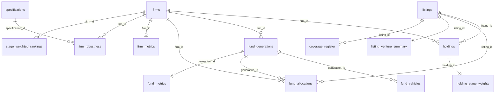

# How the tables relate

The dataset is relational: flat CSV files linked by stable identifiers. The SQLite database (`database/venture_value_per_dollar.sqlite`) enforces the same keys.

## Identifiers

| Identifier | Form | Example |
|---|---|---|
| `listing_id` | ticker at listing | `DDOG` |
| `firm_id` | lower-case slug of the firm name | `founders-fund` |
| `generation_id` | `firm_id`, two hyphens, slug of the generation label | `founders-fund--ff-ii` |
| `vehicle_id` | `firm_id`, two hyphens, slug of the fund name | `founders-fund--founders-fund-ii-lp` |
| `holding_id` | `H` and four digits | `H0452` |
| `allocation_id` | `A` and five digits | `A00001` |
| `register_id` | `G` and three digits | `G001` |

Identifiers are stable across versions: existing ones are never renumbered, and new rows take new identifiers.

## Primary keys

| Table | Primary key |
|---|---|
| `listings` | `listing_id` |
| `firms` | `firm_id` |
| `fund_generations` | `generation_id` |
| `fund_vehicles` | `vehicle_id` |
| `holdings` | `holding_id` |
| `fund_allocations` | `allocation_id` |
| `benchmark_prices` | `series_id, date` |
| `firm_metrics` | `firm_id` |
| `firm_robustness` | `firm_id, specification_id` |
| `fund_metrics` | `generation_id` |
| `listing_venture_summary` | `listing_id` |
| `holding_stage_weights` | `holding_id` |
| `stage_weighted_rankings` | `layer, firm_id` |
| `timing_weights` | `vintage, strategy` |
| `lag_distributions` | `stage_group, lag_years` |
| `strategy_parameters` | `strategy, parameter, key` |
| `specifications` | `specification_id` |
| `coverage_register` | `register_id` |

## Foreign keys

| Table | Column(s) | References |
|---|---|---|
| `fund_generations` | `firm_id` | `firms.firm_id` |
| `fund_vehicles` | `firm_id` | `firms.firm_id` |
| `fund_vehicles` | `generation_id` | `fund_generations.generation_id` |
| `holdings` | `listing_id` | `listings.listing_id` |
| `holdings` | `firm_id` | `firms.firm_id` |
| `fund_allocations` | `firm_id` | `firms.firm_id` |
| `fund_allocations` | `listing_id` | `listings.listing_id` |
| `fund_allocations` | `generation_id` | `fund_generations.generation_id` |
| `firm_metrics` | `firm_id` | `firms.firm_id` |
| `firm_metrics` | `largest_company_listing_id` | `listings.listing_id` |
| `firm_robustness` | `firm_id` | `firms.firm_id` |
| `firm_robustness` | `specification_id` | `specifications.specification_id` |
| `fund_metrics` | `generation_id` | `fund_generations.generation_id` |
| `fund_metrics` | `firm_id` | `firms.firm_id` |
| `fund_metrics` | `largest_company_listing_id` | `listings.listing_id` |
| `listing_venture_summary` | `listing_id` | `listings.listing_id` |
| `holding_stage_weights` | `holding_id` | `holdings.holding_id` |
| `stage_weighted_rankings` | `firm_id` | `firms.firm_id` |
| `coverage_register` | `listing_id` | `listings.listing_id` |
| `coverage_register` | `firm_id` | `firms.firm_id` |

Blank foreign-key values are allowed where documented: `fund_allocations.generation_id` is blank for shares held outside any fund generation (then `vehicle_outside_fund_files` names the vehicle), and `coverage_register.firm_id` is blank for pairs that were not added to the holdings.

## Common joins

- **A firm's stakes:** `holdings` ⋈ `listings` on `listing_id`, filtered on `firm_id` and `holder_type = 'core_venture'`. The firm's value V is the sum of `primary_value_counted_usd_bn`.
- **A firm's capital at risk:** `fund_vehicles` filtered on `firm_id` and `in_scope = 'Y'`; K is the sum of `capital_at_risk_usd_m`.
- **A fund's value:** `fund_allocations` filtered on `generation_id`; sum `primary_value_usd_bn`. Its capital at risk is `fund_generations.capital_at_risk_usd_m`.
- **Who owned a company:** `holdings` filtered on `listing_id`, joined to `firms` for names and `measurement_status`.
- **Totals that reconcile:** for each firm and listing, the shares in `fund_allocations` sum to 1, and their value equals the firm's holding value times `inside_capital_at_risk_share`.
